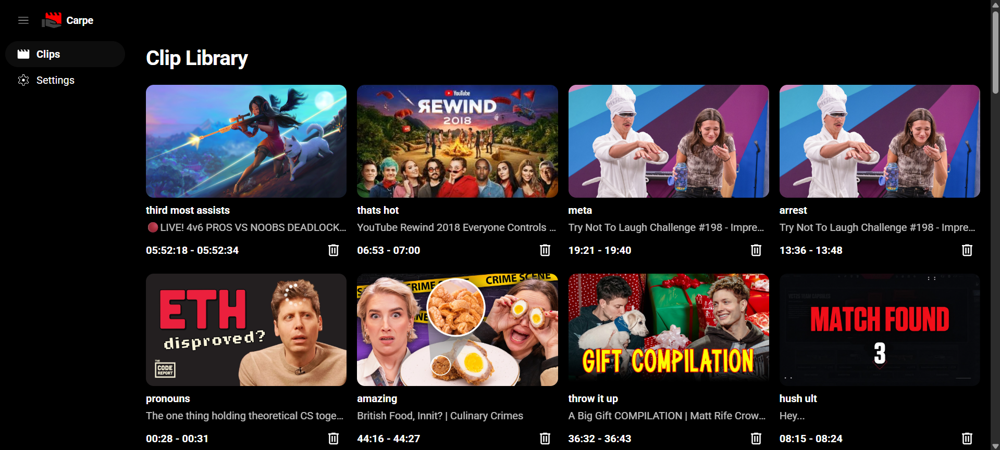
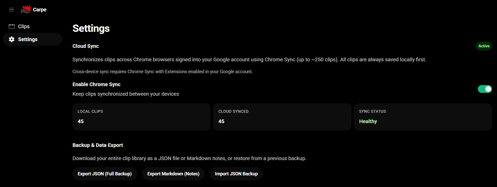

# Carpe

> **Frame-Accurate Clip Vault for YouTube** — Trim, save, and replay exact YouTube moments directly inside the player. Zero video downloads, local-first storage, and automatic Chrome Sync.


---

## Highlights

- **Frame-Accurate In-Player Trimming:** Detects the active video's frame rate (e.g., 24, 30, or 60 fps) via `requestVideoFrameCallback`, shows live `MM:SS:FF` frame timecodes right in YouTube's control bar, and lets you dial in exact start and end frames.
- **Exact Boundary Replay & Auto-Pause:** Clicking any saved clip jumps straight to the start point, handles mid-roll/pre-roll ads cleanly, and automatically pauses when the clip ends—no autoplay overflow or post-clip distractions.
- **Zero Video Downloads:** Saves lightweight clip ranges rather than bloated video files, keeping clipping instant and your disk clean.
- **Local-First Vault with Chrome Sync:** Every clip is saved locally first (`chrome.storage.local` with unlimited local storage) and synced automatically across your signed-in Chrome browsers via Chrome Sync (`chrome.storage.sync`, up to ~250 clips; can be toggled off anytime). Built-in tombstone tracking, conflict resolution, and one-click cloud archiving keep sync healthy even at quota limits.
- **Portable Backups & Markdown Notes:** Export your entire clip library as a full JSON backup (with restore) or clean Markdown notes with clickable timestamp links ready for Obsidian, Notion, or Logseq.
- **Private & Lightweight:** Zero analytics, zero tracking, zero external backends. Localized in English and Turkish.

---

## Clip Library & Settings




---

## Trimmer Keyboard Shortcuts

When creating or editing a clip in the YouTube player, adjust the active start/end anchor directly from your keyboard:

| Shortcut                       | Action                  |
| :----------------------------- | :---------------------- |
| `,` / `.` or `Alt` + `←` / `→` | Nudge by **1 frame**    |
| `Shift` + `←` / `→`            | Nudge by **1 second**   |
| `←` / `→`                      | Nudge by **5 seconds**  |
| `J` / `L`                      | Nudge by **10 seconds** |
| `Enter`                        | Save clip               |
| `Esc`                          | Cancel editing          |

---

## Architecture Overview

Carpe follows Manifest V3 best practices and isolates responsibilities across decoupled components:

```
┌─────────────────────────────────────────────────────────┐
│                     YouTube Tab                         │
│  ┌───────────────────────┐   ┌───────────────────────┐  │
│  │   src/content.ts      │   │  src/player-bridge.ts │  │
│  │  (Isolated World)     │◄──┼─►│     (Main World)   │  │
│  │  • ClipPlaybackCtrl   │   │  • YouTube Player API │  │
│  │  • TimelineTrimmer    │   └───────────────────────┘  │
│  │  • FrameRateDetector  │                              │
│  │  • PlayerOverlayView  │                              │
│  └───────────┬───────────┘                              │
└──────────────┼──────────────────────────────────────────┘
               │ IPC (chrome.runtime.sendMessage)
               ▼
┌─────────────────────────────────────────────────────────┐
│                 Background Service Worker               │
│  ┌───────────────────────────────────────────────────┐  │
│  │  src/service-worker.ts                            │  │
│  │  • Single Authoritative Sync Host Coordinator     │  │
│  │  • Alarm-driven Retry & Quota Backoff             │  │
│  │  • Cross-Tab Pending Playback Handoff             │  │
│  └───────────────────────┬───────────────────────────┘  │
└──────────────────────────┼──────────────────────────────┘
                           │
       ┌───────────────────┴───────────────────┐
       ▼                                       ▼
┌─────────────────────────────┐ ┌─────────────────────────────┐
│    chrome.storage.local     │ │     chrome.storage.sync     │
│  • Primary Clip Vault       │ │  • Automatic Cloud Sync     │
│  • Tombstones & Settings    │ │  • Multi-Device Clip Sync   │
└─────────────────────────────┘ └─────────────────────────────┘
```

- **Player Bridge (`src/player-bridge.ts`):** Injected into YouTube's `MAIN` execution world to wake up player controls and inspect video status without exposing sensitive extension APIs.
- **Frame Rate Detector (`src/content/frameDetector.ts`):** Samples `requestVideoFrameCallback` presentation times (and re-samples on quality switches) to snap to the stream's exact frame duration.
- **Playback Controller (`src/content/clipPlaybackController.ts`):** Media-event state machine managing frame callbacks, seek correction limits, boundary auto-pause, and ad-module clearance.
- **Sync Engine (`src/storage/syncEngine.ts`):** Handles bidirectional merge, TOCTOU avoidance, differential tombstone pushing, and quota exhaustion fallback.

---

## Installation (Developer Mode)

### Prerequisites

- Node.js 20+ (tested on Node 22+)
- [pnpm](https://pnpm.io/) 9+

### Build from Source

1. Clone the repository:

   ```bash
   git clone https://github.com/ferhatwi/carpe.git
   cd carpe
   ```

2. Install dependencies:

   ```bash
   pnpm install
   ```

3. Build the extension:

   ```bash
   pnpm build
   ```

4. Load into Chrome:
   - Navigate to `chrome://extensions/`
   - Enable **Developer mode** (top-right toggle)
   - Click **Load unpacked**
   - Select the `carpe` repository folder

---

## Development

```bash
# Full verification (type-check, lint, formatting check, tests, and build)
pnpm check

# Build and package Chrome Web Store release zip into dist/
pnpm release

# Run test suite (Node.js native runner with type-stripping)
pnpm test

# Type-check TypeScript sources
pnpm type-check

# Lint codebase with ESLint
pnpm lint

# Format codebase with Prettier
pnpm format
```

> [!NOTE]
> **Source vs. Build Artifacts:** The git repository tracks only TypeScript (`.ts`) source files; no compiled JavaScript is committed to git. When you run `pnpm build` locally, `build.mjs` bundles TypeScript into `.js` files in-tree (`src/content.js`, `src/service-worker.js`, `library/library.js`, etc.) so Chrome can load the extension directly. These generated `.js` files are gitignored and recreated on every build—always edit `.ts` source files.

---

## Privacy

See [PRIVACY.md](PRIVACY.md) for our Privacy Policy (English & Türkçe).

---

## Contributing

See [CONTRIBUTING.md](CONTRIBUTING.md) for coding standards, architecture rules, and testing guidelines.

---

## License

This project is licensed under the [GNU General Public License v3.0 or later](LICENSE).
